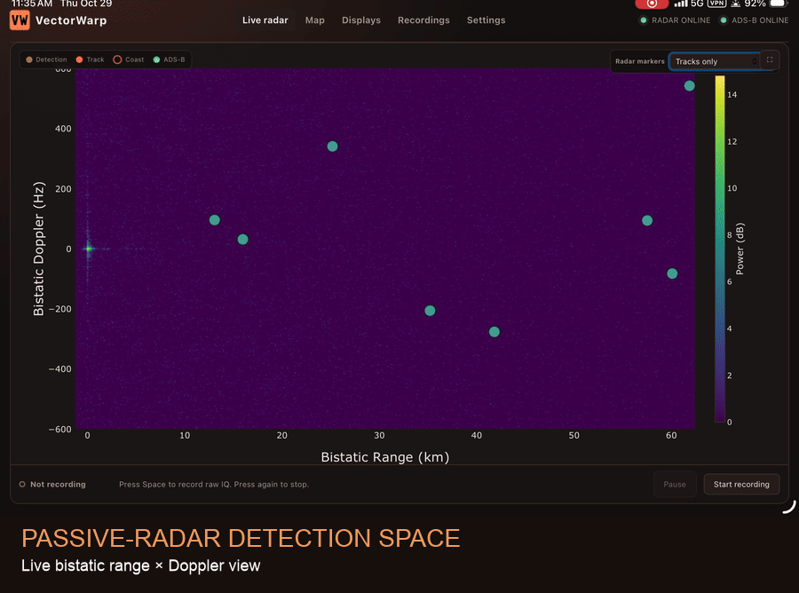
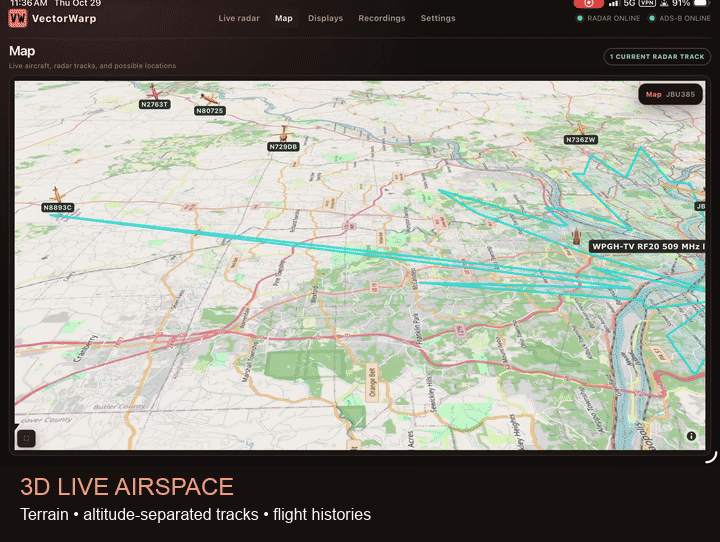

<p></p>

# VectorWarp

## Open Passive Radar Scorecard

The receiver-neutral Open Passive Radar Scorecard (OPRS) specification and
reference CLI live in [docs/PASSIVE_RADAR_SCORECARD.md](docs/PASSIVE_RADAR_SCORECARD.md)
and [docs/OPRS_RUNBOOK.md](docs/OPRS_RUNBOOK.md). OPRS keeps deterministic
synthetic, real-background injection, and held-out aircraft evidence separate;
it does not produce a weighted overall percentage.

> **THIS IS A DEVELOPMENT BUILD. EXPECT BUGS AND REPORT VIA GITHUB ISSUES PLEASE AND THANK YOU!**

VectorWarp builds on [blah2](https://github.com/30hours/blah2) with faster CPU and GPU processing, coherent multi-channel array processing, a redesigned browser interface, editable settings, built-in ADS-B integration, and native installation on Linux and macOS. Set up your radar, watch it run, and record or replay signals from the same interface.

[Install](docs/INSTALL.md) · [macOS / Homebrew](docs/MACOS_HOMEBREW.md) · [Set up a receiver](docs/SETUP.md) · [Comparison details](docs/UPSTREAM_COMPARISON.md) · [GPU acceleration](docs/GPU_ACCELERATION.md)

## See VectorWarp in action

### Live bistatic range–Doppler processing

Watch radar detections, persistent tracks, and ADS-B truth update together in
the browser.



### 3D live airspace

Explore terrain, altitude-separated aircraft, radar tracks, and flight
histories in the same interactive map.



## Choose an installation path

1. **Linux PC or ARM64 system:** install a matching signed DEB or RPM
   from the [package page](https://mickeyslaven.github.io/blah2-VectorWarp/#install).
2. **macOS:** install with [Homebrew](docs/MACOS_HOMEBREW.md), or use a signed
   PKG when the package page lists one.
3. **Development or an unsupported system:** use the
   [source-install instructions](docs/INSTALL.md#build-from-source).

Every route opens Settings before radar starts. Configure a receiver or replay
file there, then choose **Save & Restart**. RSPduo users must install SDRplay's
vendor API themselves and choose **Build SDRplay support** before that first
start; VectorWarp does not distribute the vendor software.

## What you get beyond blah2

- **GPU acceleration:** use a compatible GPU for clutter filtering and delay–Doppler processing, with automatic selection and CPU fallback.
- **Faster without a GPU, too:** less copying, repeated detector work and output conversion; CPU-only processing took up to 26% less time in the matched desktop/laptop tests below.
- **Wider Doppler coverage:** process valid delay/Doppler combinations that exceed the original processor's buffer limits. See the equal-range results below.
- **Automatic CPU threading:** size channel workers and FFT threads to the CPU capacity available, with manual controls when you need them.
- **Settings in your browser:** edit receiver, processing, display, recording, and ADS-B settings in organized sections.
- **Checked inputs:** dropdowns, range checks, and short explanations help catch invalid settings before they reach the processor.
- **Save & Restart:** apply settings and follow restart progress, with an error message if startup fails.
- **Recoverable configuration:** backups and file-change checks help protect your settings, including when you also edit the config file directly.
- **Kraken configuration checks:** compare the receiver's reported frequency, sample rate, and channel count with VectorWarp's settings.
- **Coherent Kraken arrays:** use 2–8 synchronized inputs, synthesize the broadcast reference from several elements, and keep every selected channel available for surveillance.
- **Calibrated 360-degree beam banks:** combine coherent surveillance maps with measured per-channel phase and gain instead of relying only on ideal antenna geometry.
- **Weak-echo controls:** optionally integrate two CPIs or use GPU-resident track-before-detect banks over 2/4/8 CPIs, with limited motion search, optional joint coarse-angle trajectory gating, exact multi-CPI CFAR thresholds, calibrated beam/motion trials, candidate-only fine coherent beam refinement, and a bounded direct-path null.
- **Spatially aware tracking:** retain the winning beam with each detection and optionally require bearing-consistent associations without changing the public track or Retina data formats.
- **Bounded GPU tracking:** cap resident tracker memory and recover capacity deterministically instead of allowing an overloaded tracker to grow without limit.
- **Efficient weak-target initiation:** optionally replace duplicate acceleration-hypothesis tracks with one acceleration-aware tentative track, solve its joint delay/Doppler motion envelope continuously, and compact internal history without shortening public trails—freeing capacity for more detections.
- **Persistent-clutter-aware initiation:** GPU-resident tracking defaults to a bounded temporal clutter map that learns recurring low-Doppler cells and prevents only new hypotheses from starting there. Existing aircraft tracks remain eligible while crossing zero Doppler, raw detections stay available, and stationary bearing hypotheses remain available through the API while the map hides them by default.
- **Geometry-safe GPU scratch:** full-span clutter filters no longer depend on an incidental borrowed-buffer size; VectorWarp reuses native storage when it fits and allocates dedicated postprocess scratch only when the configured geometry needs it.
- **Unassisted external tracking with loss-resistant publication:** optionally copy the newest detection frame to a local tracker without ADS-B reads, publish its stable identities as primary, retain persistent non-overlapping native tracks as a weak-target safety net, and fall back automatically if the external stream becomes stale. See [External tracker feed and safe publication](docs/EXTERNAL_TRACKER_SHADOW.md).
- **A redesigned interface:** clearer navigation, readable controls, live status, and fullscreen radar views.
- **Bearing-aware bistatic mapping:** an opt-in GPU-resident path can use the calibrated coherent scan or local complex-covariance MVDR scoring, load a measured direction-dependent array manifold, retain three independent lobes per CPI, and follow those hypotheses with angular-rate constraints. A bearing-only channel permutation makes cable/element mapping testable without changing detection. A separate API accumulates candidate intersections as the aircraft crosses changing delay ellipses, favors physically plausible speed/acceleration paths, and publishes uncertainty corridors; unresolved results remain candidates rather than falsely precise aircraft positions. The legacy tracker and Retina feeds are unchanged, and ADS-B is validation-only.

See [Bearing and bistatic geolocation](docs/BEARING_GEOLOCATION.md) for the data contract, uncertainty rules, configuration gate, and geolocation math.
- **Built-in ADS-B conversion:** the adsb2dd integration runs inside VectorWarp; no separate converter process to manage.
- **Automatic installed-array calibration:** eligible coherent Kraken sites collect bounded sparse complex echo vectors in the background, label them with built-in ADS-B truth, and fit a site-specific measured manifold without a separate tool. Whole aircraft passes are withheld for a shadow A/B test against the default free-space model; minimum pass, aircraft, sector, error, and no-regression gates must all pass before an atomic promotion and controlled restart. Site-setting changes invalidate the auto-selected model, ADS-B never enters live inference, and the wiring diagnostic remains shadow-only.
- **Local or remote aircraft feeds:** discover a local decoder or connect to a tar1090 server on another machine.
- **Clear recording controls:** start recording from the browser or keyboard, with a visible recording indicator and error reporting.
- **Portable recording and replay:** capture multi-channel IQ, replay it at the original sample rate, and use recordings without connecting live hardware.
- **Processing fixes:** corrected detection SNR, track association, spectrum scaling, incomplete multi-CPI startup output, and invalid-data handling, with regression tests.
- **Native Linux and macOS operation:** run without Docker, with Linux packages for Ubuntu, Debian, Fedora, and DragonOS, plus [Homebrew source installation on macOS](docs/MACOS_HOMEBREW.md). Apple Silicon is tested on M2; Intel source-level CI support remains experimental.

[Detailed changes from upstream](docs/UPSTREAM_COMPARISON.md) · [Recording and replay](docs/SETUP.md#recording-replay)

Using several radar nodes with 3lips? See [3lips setup](docs/3LIPS_SETUP.md), including its separate ADS-B requirements.

## Faster processing in practice

VectorWarp's optional Vulkan GPU path can make a practical radar workload keep
up where regular blah2 falls behind. CPU mode remains available, and Automatic
mode checks accuracy before retaining GPU work. At 200 ms CPI and ±2400 Hz,
these hosts used **about 25% less CPU-only processing time**, or **64–71% less
with GPU acceleration**, than original blah2.

On the older Pavilion CPU alone, the ±800 Hz workload dropped from 205.7 to
167.8 ms. Original blah2 missed all 24 measured 200 ms deadlines; VectorWarp
met all 24 without a GPU.

| Two channels, same IQ and CPU budget | Regular blah2 CPU | VectorWarp CPU | VectorWarp GPU |
| --- | ---: | ---: | ---: |
| Strix, 200 ms CPI, ±800 Hz | 79.5 ms | 65.5 ms | **31.1 ms** |
| RTX 4050 Laptop, 200 ms CPI, ±800 Hz | 230.5 ms | 180.9 ms | **63.6 ms** |
| Pavilion AMD GPU, 200 ms CPI, ±2400 Hz | 306.8 ms | 229.9 ms | **88.1 ms** |

The comparison used actual [30hours/blah2 at `c821bee`](https://github.com/30hours/blah2/tree/c821bee3f0d27cf20c8447f3d908ef722905a4de)
and VectorWarp on each host, replaying the same recorded signal at its original
rate. Every comparison used 527 MHz, 2.4 MS/s, delays −10…245 (256 bins; 30.604
km maximum excess path), and the stated channel count. Accuracy qualification
runs at startup; accepted GPU frames do not repeat the full CPU calculation.
[Full timing distributions and method](docs/GPU_BENCHMARK_20260911.md)
are available before sizing a live system.

The GPU accelerates clutter FFT/filtering and delay–Doppler processing. Its small
FP64 coefficient solve and the remaining radar stages stay on CPU. [Full method,
settings, deadline counts, accuracy checks, and limitations →](docs/GPU_BENCHMARK_20260911.md)

**Earlier live proof:** at 527 MHz and 2.4 MS/s, a five-channel Kraken array GPU run
at ±800 Hz and 200 ms CPI averaged **95.5 ms**. This is capacity evidence, not
a matched upstream speed comparison. It used the prior version with recurring
CPU accuracy checks; the refreshed measurements above are recorded-IQ replays,
not new live or endurance tests.

## Equal-range Doppler tests

At this same full range and **±4800 Hz**, Strix GPU processing averaged **67.0 ms
per 200 ms CPI**, or **325.5 ms per one-second CPI**. VectorWarp CPU took 173.8 ms
and 886.0 ms respectively; both modes met all 24 steady deadlines in each case.
Original blah2's Doppler buffer is too small for
these settings; it was not run with unsafe buffer sizes.

The combined efficiency changes also reduced the Strix ±2400 Hz GPU workload
from 69.7 to 44.7 ms versus the preceding VectorWarp version in the same campaign.
[Before/after results and remaining processing costs](docs/GPU_BENCHMARK_20260911.md#remaining-processing-costs)
keep that separate from the upstream comparison. Heavier workloads can still
miss deadlines; the full report includes every tested configuration.

## Install on macOS with Homebrew

With Homebrew and Xcode Command Line Tools installed:

```sh
brew tap mickeyslaven/vectorwarp
brew trust mickeyslaven/vectorwarp
brew install vectorwarp
vectorwarp
```

This builds the app and local USB Kraken companion and opens Settings.
Configure a receiver or replay file, then choose **Save & Restart** to start
processing. See the [Homebrew guide](docs/MACOS_HOMEBREW.md) for prerequisites,
services, updates and removal, and the [Mac guide](docs/MACOS.md) for receivers.

Apple Silicon is tested on the development M2. Intel is experimental, with
source-level CI coverage but no physical receiver, GPU, or installed-Homebrew
qualification. The public tap builds from source; no bottle is supplied.
The tap's update and restart commands are in the
[Homebrew guide](docs/MACOS_HOMEBREW.md#public-tap-updates).
The standalone macOS installer is documented separately in
[MACOS_STANDALONE.md](docs/MACOS_STANDALONE.md). The universal package is
Developer ID signed and Apple-notarized. When the [download matrix](https://mickeyslaven.github.io/blah2-VectorWarp/#install)
lists a macOS PKG, it installs the app at `/Applications/VectorWarp.app`; launch it with
`/Applications/VectorWarp.app/Contents/MacOS/VectorWarp`.

## Install on Linux

Start with [downloads and APT/DNF setup](https://mickeyslaven.github.io/blah2-VectorWarp/#install). The [full installation guide](docs/INSTALL.md) also covers source builds.

### 1. Install VectorWarp

There is one package per OS and architecture, with Kraken, USRP and HackRF
adapters plus locally buildable RSPduo support. Packages cover the listed
64-bit Ubuntu, Debian and Fedora releases. Copy the command for your OS. It
installs the prerequisites, adds our signed repository, installs VectorWarp,
and opens the web interface. Enter your administrator password if prompted.

```bash
# Ubuntu or Debian
sudo apt update && sudo apt install -y curl gnupg && curl --fail --location --proto '=https' --tlsv1.2 https://mickeyslaven.github.io/blah2-VectorWarp/install.sh --output vectorwarp-install.sh && sudo bash vectorwarp-install.sh --repo-only && sudo apt update && sudo apt install -y vectorwarp && vectorwarp
```

```bash
# Fedora
sudo dnf install -y curl gnupg2 && curl --fail --location --proto '=https' --tlsv1.2 https://mickeyslaven.github.io/blah2-VectorWarp/install.sh --output vectorwarp-install.sh && sudo bash vectorwarp-install.sh --repo-only && sudo dnf install -y vectorwarp && vectorwarp
```

The [installer source](script/install-release.sh) is available to read separately.

### 2. Configure and start radar

Open **Settings**, select and configure the receiver, then choose **Save &
Restart**. This saves the first configuration and starts radar; no separate
`vectorwarp start` is needed. See [receiver setup](docs/SETUP.md) for receiver
details.

### 3. Use controls and help

`vectorwarp` (or `vectorwarp open`) opens only the web interface.
`vectorwarp start` starts the full VectorWarp stack; `vectorwarp stop` stops it,
including the web page; and `vectorwarp restart` restarts it in order.
Use `vectorwarp status`, `vectorwarp logs` and `vectorwarp help` to inspect it.
Check the installed version with `vectorwarp version` on Linux or
`brew list --versions vectorwarp` on macOS. For a service-managed Mac instance,
use the [Homebrew service controls](docs/MACOS_HOMEBREW.md#optional-per-user-service).
These commands and upgrades never stop shared Kraken Suite or SDRplay services.

### 4. Update

Keep the configured repository; do not rerun the installer. Choose one block:

```bash
# Ubuntu or Debian
sudo apt update && sudo apt install vectorwarp
```

```bash
# Fedora
sudo dnf upgrade --refresh vectorwarp
```

Upgrades to version 0.1.7 or newer restore only the VectorWarp services that
were running; intentionally stopped radar stays stopped.
Finish receiver setup/build actions before updating. If the upgrade cannot
stop a helper safely, it reports the problem before unpacking new files.

## SDR support

- **KrakenSDR Suite V2:** 2–8-channel network input, synthesized or dedicated reference, and combined surveillance maps.
- **USRP (including B210) and dual HackRF:** receiver settings are passed to UHD or libhackrf when processing starts.
- **SDRplay RSPduo:** uses your locally installed SDRplay API; Settings checks installation and service status and links to [SDRplay setup](docs/SDRPLAY_SETUP.md) when needed.

The Kraken multi-channel foundation is also offered to blah2 in
[our upstream PR #45](https://github.com/30hours/blah2/pull/45).
VectorWarp adds the interface, integration, and processing improvements above;
the PR remains separate.

## OS support

The repository installer chooses the matching signed APT or DNF repository.
For a direct download, use the current, auto-generated
[installation page](https://mickeyslaven.github.io/blah2-VectorWarp/#install),
which lists only packages in the selected release. Source installation remains
available for development or unsupported systems.

| Operating system | Versions | Architectures | Package |
| --- | --- | --- | --- |
| Ubuntu | 22.04, 24.04, 26.04 | x86-64, ARM64 | [DEB downloads](https://mickeyslaven.github.io/blah2-VectorWarp/#install) |
| Debian | 12 (Bookworm) | ARM64 | [DEB downloads](https://mickeyslaven.github.io/blah2-VectorWarp/#install) |
| Debian | 13 (Trixie) | x86-64, ARM64 | [DEB downloads](https://mickeyslaven.github.io/blah2-VectorWarp/#install) |
| Fedora | 44 | x86-64, ARM64 | [RPM downloads](https://mickeyslaven.github.io/blah2-VectorWarp/#install) |
| DragonOS | Matching Ubuntu base | x86-64, ARM64 | [Use `/etc/os-release` metadata](docs/DRAGONOS.md) |
| macOS | 26.6.1 tested on M2 | Apple Silicon / ARM64 | [Public Homebrew tap](docs/MACOS_HOMEBREW.md) |
| macOS | Experimental source-level CI; hardware, GPU and Homebrew unverified | Intel / x86-64 | [Build target and limits](docs/MACOS_TEST_MATRIX.md) |

macOS development is documented in [the local build guide](docs/MACOS.md).
Apple Silicon (`arm64`) has been exercised locally on an Apple M2 running macOS
26.6.1, including CPU/replay, browser configuration and lifecycle, local
Homebrew app/companion revision 17, and a calibrated local USB Kraken run.
Vulkan through MoltenVK is qualified on that M2 for ambiguity and clutter, with
CPU fallback retained. Intel (`x86_64`) is an experimental source-level CI
target: its `macos-15-intel` job passed CPU, open receiver-adapter, synthetic
Kraken, replay, API, browser, and lifecycle checks. It has no physical receiver,
GPU, or installed-Homebrew claim.
The public Homebrew tap is managed by the
[main-merge workflow](docs/HOMEBREW_PUBLISHING.md). Release downloads appear in
the [installation matrix](https://mickeyslaven.github.io/blah2-VectorWarp/#install).
See [macOS validation limits](docs/MACOS_TEST_MATRIX.md).

Here, x86-64 means `amd64` or `x86_64`; ARM64 means `arm64` or `aarch64`.

## Credits and license

Thanks to [30hours](https://github.com/30hours/blah2) for the original radar
engine. Comparisons use [blah2 at c821bee](https://github.com/30hours/blah2/tree/c821bee3f0d27cf20c8447f3d908ef722905a4de).
By default, ADS-B is used for display and evaluation, not radar detection or
tracking input. The explicitly enabled external shadow feed is the exception:
it can annotate a separate experimental tracker while leaving VectorWarp's
built-in detector, tracker, bearing path, and Retina output unchanged.
[MIT license](LICENSE)

## Limited platform: Raspberry Pi 4B

Raspberry Pi 4B is a compatibility/preview target, not a recommended primary
VectorWarp platform. Its tested workloads are substantially slower than the
desktop and laptop systems above, and production-size processing may not keep
up in real time. Prefer a supported x86-64 PC or Apple Silicon Mac when possible.

| Operating system | Versions | Architectures | Package |
| --- | --- | --- | --- |
| Raspberry Pi OS | Bookworm, 64-bit | ARM64 | [Pi 4 preview image](https://github.com/mickeyslaven/blah2-VectorWarp/releases/tag/v0.1.10-pi4-preview) |

If this constrained platform is still appropriate, use the
[Pi 4 preview guide](docs/PI4_GUIDE.md) and its
[Imager manifest](https://github.com/mickeyslaven/blah2-VectorWarp/releases/download/v0.1.10-pi4-preview/vectorwarp-pi4-0.1.10.rpi-imager-manifest).
The tested baseline is an 8 GB Pi 4B with Bookworm Lite and a 32 GB microSD
card. Fresh-card boot and Wi-Fi qualification remain incomplete; see the
[validation limits](docs/PI4_IMAGE_VALIDATION_20260919.md). The separate preview
does not preconfigure the stable package repository.

At 200 ms CPI and ±800 Hz, the Pi 4 CPU workload took **798.2 ms** in
VectorWarp versus **905.1 ms** in original blah2 and **905.9 ms** in the ARM
fork. A separate replay with a newer Mesa driver improved VectorWarp from
**797.2 ms CPU-only to 578.1 ms with GPU Automatic**, but still missed the
200 ms deadline. See the [Pi comparison](docs/PI4_PERFORMANCE_20260911.md) and
[GPU limits](docs/PI_GPU_SETUP.md#pi-4-driver-diagnostic).
